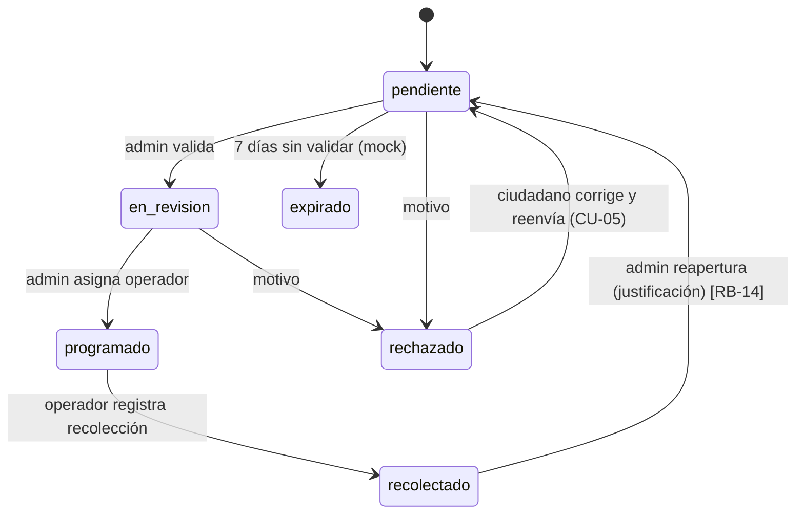
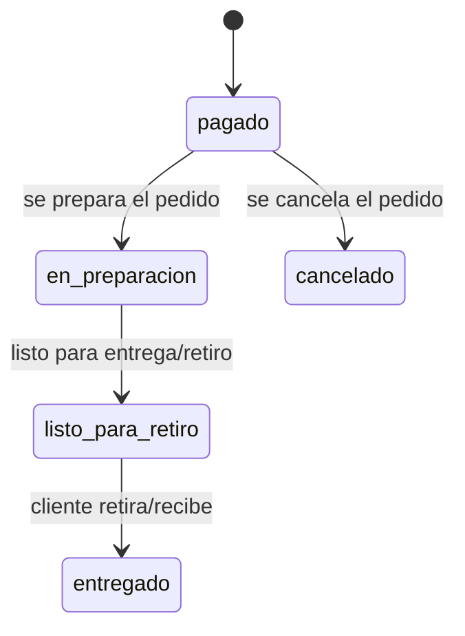
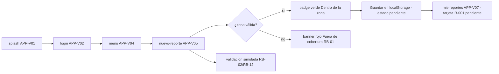
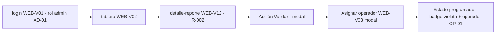
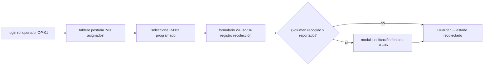

# SPEC — Especificación técnica del prototipo de vistas

**Sistema:** Sistema de registro de escombros — prototipo de vistas (reto #3 "Escombros a recursos")
**Componente:** App móvil de reporte de escombros (vistas) + Web de registro de puntos de recolección (vistas) + Venta de adoquines reciclados (tipo Trebol) en app móvil (vistas simuladas)
**Fase:** Especificación técnica del prototipo (sin backend, sin base de datos, sin lógica de negocio ejecutable)
**Autor:** Senior Software Architect & Technical Product Analyst
**Fecha:** Noviembre 2026
**Documento fuente:** [`PRD.md`](./PRD.md) (requisitos del prototipo definidos por Ingeniería de Sistemas)
**Stack decidido:** HTML5 + CSS3 nativo + TypeScript (wireframes desde cero, sin framework, sin Figma, sin CDN)
**Alcance estricto de la SPEC:** traducir los requisitos del PRD a especificación técnica. El flujo de venta de adoquines es solo vista simulada: no hay pago real, no hay transacción, no hay inventario real. Todo lo de negocio, cotización, Modelo Canvas, pitch y diseño 3D queda fuera.

---

## 1. Propósito y alcance de esta especificación

### 1.1 Propósito
Traducir los requisitos funcionales y no funcionales del `PRD.md` a una especificación técnica ejecutable para construir el **prototipo de vistas** de tres áreas:

1. **App móvil** (vistas del ciudadano reportante) — marco móvil simulado en navegador.
2. **Web** (vistas de operador y administrador) — interfaz de escritorio/tablet simulada en navegador.
3. **App móvil** (vistas de venta de adoquines reciclados, tipo Trebol) — marco móvil simulado en navegador; flujo de compra simulado sin pago real.

Sin backend, sin base de datos, sin servidor, sin lógica de negocio ejecutable, sin autenticación real, sin exportación real de archivos. Los servicios se **simulan** con módulos TypeScript y datos mock (`mock.ts` + `localStorage`).

### 1.2 Qué NO es esta especificación
- No es una especificación de API REST real: los "endpoints" de la §7 son **contratos de servicio simulados** para el prototipo, con un mapeo documental de fase 2 (informativo, no tarea).
- No es una especificación de negocio (el PRD ya delimita: fuera del rol de Ingeniería de Sistemas).
- No es un plan de proyecto/sprints: el orden de construcción sugerido está en §13.

### 1.3 Convención de IDs
- `R-xxx` → entidades de datos (reportes demo).
- `SPEC-C/A/W/V/xx` → requisitos técnicos traducidos.
- `ADR-n` → decisiones de arquitectura.
- `NFR-x` → requisitos no funcionales.
- `TAC-x` → criterios técnicos de aceptación.
- `RT-n` → riesgos técnicos (prefijo distinto de `R-` para no chocar con reportes).
- `A-n` → hallazgos/ambigüedades del PRD (§12).
- `G-n` → decisiones de arquitectura de alto nivel (registradas en el log de decisiones del harness).

---

## 2. Análisis del PRD y trazabilidad de requisitos

### 2.1 Resumen del análisis
| Aspecto del PRD | Veredicto | Tratamiento en esta SPEC |
|-----------------|-----------|--------------------------|
| Alcance estricto: solo vistas, sin backend | Claro y coherente | Toda la arquitectura es front-end estático (§5) |
| Actores: ciudadano, operador, admin, cliente comprador | Cuatro perfiles | Cuatro perfiles de sesión simulada (§5.3, ADR-10) |
| Estados del reporte (RB-04) | Claro | Máquina de estados visual (§6.5) |
| Estados del pedido (RB-16) | Nuevo | Máquina de estados visual de pedidos (§6.5) |
| KPIs del prototipo | Ejecutables | Criterios de aceptación técnicos (§11) |
| Criterios de aceptación UI (CA-APP-V*, CA-WEB-V*) | Claros | Desglose en criterios técnicos verificables (§11.2) |
| Reglas ilustrativas RB-01…RB-16 | Claro con matices | Mapeo regla → implementación visual (§9) |
| Catálogos (tipos de escombro, destinos, adoquines) | **Abiertos** en el PRD | Fixtures por defecto definidos aquí (§6.3), marcados provisionales |
| Ambigüedades y vacíos | Ver tabla completa | **§12** (hallazgos con decisión por defecto) |

### 2.2 Matriz de trazabilidad PRD → SPEC

| Requisito del PRD | Tipo | Especificación técnica |
|-------------------|------|------------------------|
| APP-V01…V10 (vistas de app reporte) | Funcional | §3.2 + §11.2 (TAC-APP-*) |
| APP-V11…V15 (vistas de app venta adoquines) | Funcional | §3.4 + §11.2 (TAC-VENTA-*) |
| WEB-V01…V11 (vistas de web) | Funcional | §3.3 + §11.2 (TAC-WEB-*) |
| CU-01…CU-07 (flujos) | Funcional | §8 (flujos + datos de demo) |
| RB-01…RB-16 (reglas) | Funcional/regla | §9 (mapeo regla → implementación visual) |
| Wireframes desde cero HTML/CSS/TS | Restricción | ADR-01…ADR-10 (§4) |
| Sin backend / sin DB / sin lógica ejecutable | Restricción | §5.1 (arquitectura), §7 (servicios simulados) |
| Persistencia simulada (localStorage) | Funcional | §5.3, ADR-04, §7.17 |
| Mapa estático de la zona | Funcional | §5.3 (`ui/mapShape`) + ADR-06 |
| KPI ≥ 5 imágenes para pitch | Entregable | §11.5 (TAC-EVID) |
| Prototipo navegable | Ambigüedad | Hallazgo A-08 (§12): **navegable** es el entregable principal |

### 2.3 Decisión de arquitectura registrada
**G-01** (importancia 5, permanente): El alcance de la app móvil se extiende con el flujo de venta de adoquines reciclados (tipo Trebol) como **vista simulada**: catálogo, detalle, carrito, pedido simulado y mis pedidos. El pago real, la transacción y el inventario real quedan fuera (RB-15, RB-16).

---

## 3. Requisitos funcionales traducidos a especificaciones técnicas

Los IDs del PRD (APP-V*, WEB-V*, CU-*, RB-*) se conservan como fuente. Aquí se traducen a requisitos técnicos con ID propio (`SPEC-*`).

### 3.1 Núcleo / core (común)

| ID | Requisito técnico | Fuente |
|----|-------------------|--------|
| SPEC-C01 | El prototipo es un **sitio estático multi-página (MPA)** servible en GitHub Pages sin proceso de servidor. Cada vista es un archivo HTML navegable por URL. | ADR-01 |
| SPEC-C02 | La navegación entre vistas es **simulada**: enlaces reales (`<a href>`) + script de inicialización por página que lee sesión/parámetros de `localStorage` y renderiza datos mock. | ADR-04 |
| SPEC-C03 | Los datos provienen de una única fuente de verdad (`src/data/mock.ts`, compilado a `dist/`), con seed inicial a `localStorage` la primera vez. | ADR-03 |
| SPEC-C04 | Los catálogos (tipos de escombro, destinos, adoquines, operadores, roles) están tipados como `const` y renderizados desde data, nunca hard-codeados en las vistas. | §6.3 |
| SPEC-C05 | La sesión está simulada con un perfil activo y selector de rol que determina qué vistas/acciones son visibles (RB-10). | ADR-10 |
| SPEC-C06 | Todo texto/etiqueta de estado se renderiza con el componente `status-badge` que mapea estado → color/etiqueta vía tokens CSS. | §6.5 |
| SPEC-C07 | El mapa de la zona es un **SVG estático** (polígono + marcadores) sin tiles externos ni servicios de mapas. | ADR-06 |
| SPEC-C08 | La notificación in-app es un **toast local** o badge en "Mis reportes"; no se envía nada a ningún backend. | Hallazgo A-01/A-12 (§12) |

### 3.2 App móvil — Vistas de reporte de escombros (APP-V*)

| ID | Requisito técnico | Fuente |
|----|-------------------|--------|
| SPEC-A01 | El shell móvil usa un **marco de teléfono simulado** (aspect ratio ~9:19.5, ancho máx. 390px) centrado en la vista; dentro de él se renderizan las vistas del ciudadano. | ADR-05 |
| SPEC-A02 | APP-V05 "Nuevo reporte" incluye: área de foto con placeholder clicable (simula cámara/galería: al pulsar inserta foto placeholder con badge "GPS ✓ · 14:32 ✓"), selector de tipo (radio-group con los 5 catálogos), selector de volumen con opciones predefinidas (<1, 1–3, 3–6, 6–10, >10 m³), textarea de descripción, botón Enviar. | APP-V05 |
| SPEC-A03 | La validación de zona (APP-V06) se implementa como **estado/overlay dentro de APP-V05** (banner verde/rojo sobre el indicador GPS) y, para la demo, también existe `validacion-zona.html` como pantalla dedicada que muestra ambos resultados. | APP-V06, CU-01, A-09 |
| SPEC-A04 | APP-V07 "Mis reportes" renderiza tarjetas con ID, fecha, tipo, volumen m³, ubicación corta y `status-badge`; con filtros por estado (chips) e ítems de datos simulados que cubren **los 6 estados**. | APP-V07, RB-04 |
| SPEC-A05 | APP-V08 "Detalle de reporte" muestra foto, mapa mini, todos los campos del reporte, timeline de estados y banner de notificación si el estado cambió (leído de `localStorage`). Si el estado es `rechazado`, incluye motivo y botón "Corregir y reenviar" que abre APP-V05 en **modo edición** (campos precargados; reenviar restaura estado `pendiente`). | APP-V08, CU-05 |
| SPEC-A06 | APP-V10 "Mapa de reportes propios" es SVG estático con marcadores de los reportes del usuario y leyenda de colores por estado. | APP-V10 |
| SPEC-A07 | El shell móvil incluye **banner global de conexión simulada** ("Sin conexión — guardando localmente") controlado por un toggle del entorno demo (para exhibir RB-13). | RB-13 |
| SPEC-A08 | APP-V02/APP-V03 (login/registro) son formularios **sin validación real de credenciales** (cualquier entrada avanza); muestran validación visual de campos obligatorios (formato correo/teléfono con regex de demo) y navegan a APP-V04. | APP-V02, APP-V03 |
| SPEC-A09 | APP-V09 "Perfil" permite editar nombre/contacto (persistencia en `localStorage` namespaced) y **cerrar sesión simulada** (limpia la sesión). | APP-V09 |

### 3.3 Web — Vistas de registro de recolección (WEB-V*)

| ID | Requisito técnico | Fuente |
|----|-------------------|--------|
| SPEC-W01 | Shell web con **sidebar + topbar**; el menú y las rutas visibles dependen del rol activo (`operador` ve tablero con filtro "mis asignados", recolección, historial; `admin` ve todo, incluidas métricas, exportación, usuarios, destinos). | WEB-V01, RB-10 |
| SPEC-W02 | WEB-V02 "Tablero" es la vista central: dos paneles — (a) lista/tarjetas de reportes con filtros por estado y tipo, (b) mapa SVG estático de la zona con pines por reporte. Filtros combinables y **badges de alerta** (duplicado, fuera de zona, residuo peligroso, pendiente de validar). | WEB-V02, RB-08, RB-11 |
| SPEC-W03 | **WEB-V12 "Detalle de reporte"** (vista añadida por esta SPEC, ausente en el PRD — ver A-02 §12): ficha completa del reporte con foto, mapa mini, timeline de estados, datos del ciudadano y acciones del rol activo (Validar, Asignar, Rechazar con motivo, Reabrir). | CU-02, CU-03, CU-04, RB-14 |
| SPEC-W04 | WEB-V03 "Asignación" es un **modal sobre el detalle**: selector de operador (de catálogo mock) + fecha estimada → cambia estado a `programado`. | WEB-V03 |
| SPEC-W05 | WEB-V04 "Registro de recolección" formulario con: lugar (coordenadas mock + dirección), fecha/hora, tipo (solo lectura), volumen recogido (m³), **peso estimado (kg)**, destino (select del catálogo), foto antes/después (placeholders), responsable y vehículo. | WEB-V04 |
| SPEC-W06 | WEB-V05 "Cambio de estado" es un **modal** desde el detalle/tablero con acciones según rol: Programado (admin), Recolectado (operador), Rechazado (admin, con select de motivo). | WEB-V05 |
| SPEC-W07 | WEB-V06 "Reapertura" es un modal solo-admin (RB-14) que exige justificación escrita (≥ 20 caracteres) y deja registro en el timeline. | WEB-V06, RB-14 |
| SPEC-W08 | WEB-V08 "Exportación" es una **tabla estática** mock con las 10 columnas del PRD y botón "Descargar CSV" que **solo muestra un modal de simulación** ("Archivo generado — simulado"). Sin descarga real (fuera de alcance). | WEB-V08 |
| SPEC-W09 | WEB-V09 "Gestión de usuarios": tabla de operadores/admins mock con acciones crear/editar/desactivar que mutan el mock en `localStorage` (solo efecto visual). | WEB-V09 |
| SPEC-W10 | WEB-V10 "Métricas": 4 tarjetas (total reportes, recolectados, volumen m³ acumulado, % cobertura) con valores derivados del mock al cargar (solo conteo sobre el dataset demo fijo). | WEB-V10 |
| SPEC-W11 | WEB-V11 "Historial": tabla de recolecciones con filtro por fecha y operador (client-side, sobre el mock). | WEB-V11 |
| SPEC-W12 | WEB-V07 "Catálogo de destinos": tarjetas/lista de destinos con tipo, dirección y punto de mapa (solo lectura; editable por admin con form mock). | WEB-V07 |

### 3.4 App móvil — Vistas de venta de adoquines reciclados (APP-V*)

| ID | Requisito técnico | Fuente |
|----|-------------------|--------|
| SPEC-V01 | APP-V11 "Catálogo de adoquines" renderiza lista de adoquines reciclados (tipo Trebol y otros) con imagen placeholder, nombre, precio unitario simulado y botón "Agregar al carrito". | APP-V11 |
| SPEC-V02 | APP-V12 "Detalle de adoquín" muestra imagen, descripción, precio unitario simulado, selector de cantidad (número entero ≥ 1) y botón "Agregar al carrito". Muestra stock simulado (RB-16). | APP-V12 |
| SPEC-V03 | APP-V13 "Carrito de compras" muestra lista de ítems con nombre, cantidad, precio unitario, subtotal por ítem y subtotal total simulado; botón "Pagar (simulado)" que no realiza cobro real. | APP-V13 |
| SPEC-V04 | APP-V14 "Pedido simulado" muestra resumen de compra (ítems, cantidades, subtotal), número de pedido generado (PED-xxx) y confirmación sin cobro real; mensaje "Pedido simulado — sin transacción real". | APP-V14, RB-15 |
| SPEC-V05 | APP-V15 "Mis pedidos" renderiza tarjetas con número de pedido, fecha, estado simulado (Pagado / En preparación / Listo para retiro / Entregado / Cancelado), subtotal y badge de estado. | APP-V15 |
| SPEC-V06 | El flujo de venta es navegable desde el menú principal (APP-V04) con la opción "Catálogo de adoquines" y desde el detalle de reporte no hay vínculo directo (ámbitos separados). | CU-07 |

---

## 4. Decisiones de arquitectura (ADR — formato resumido)

| ADR | Decisión | Justificación | Consecuencia |
|-----|----------|---------------|--------------|
| ADR-01 | **MPA estático multi-página** (no SPA) para las vistas del prototipo | Cada vista es enlazable por URL y navegable; funciona directo en GitHub Pages sin rewrites; Playwright CLI lo verifica fácilmente con `screenshot`/`snapshot`. | La navegación es por `<a href>` real. Más sencillo y fiel a un "wireframe" navegable. |
| ADR-02 | **TypeScript en modo strict**, target **ES2017**, output ES modules a `dist/` compilado y **incluido en el commit** (GitHub Pages no ejecuta builds). ES modules relativos, sin bundler. | Tooling mínimo (solo `tsc`); cero dependencias de runtime. | Se debe compilar antes de deploy: `npx tsc` genera `dist/`. Riesgo de desincronización src ↔ dist → script `build` obligatorio pre-commit (RT-06). |
| ADR-03 | **Única fuente de mocks**: `src/data/mock.ts` tipado (interfaces de §6), exportado como objeto de datos; en el primer render se siembra a `localStorage` para persistir los cambios de la demo. | Evita mocks duplicados y drift entre vistas. | Cambiar datos demo solo toca `mock.ts`. Si en fase 2 hay backend, se reemplazan los servicios (§7) sin tocar vistas. |
| ADR-04 | **`localStorage` namespaced y versionado** (prefijo `cnsv1:`): sesión, catálogos mutados, mutaciones de reportes/recolecciones/pedidos, preferencias demo (toggle offline). | La persistencia simulada hace creíble la demo (cambiar estado en web → cambia badge en app). El prefijo evita colisiones. | Riesgo de estado demo "sucio" entre corridas → botón "Reiniciar demo" que limpia las keys (en shell web y app) (RT-05). |
| ADR-05 | **Tokens de diseño en CSS custom properties** (`tokens.css`) + clases semánticas estilo BEM (`.card`, `.badge--recolectado`); mobile first; shell móvil con device frame CSS; shell web con layout sidebar. | Consistencia visual sin dependencias de framework. UI legible para el jurado. | Colores fuera de tokens prohibidos (verificable con grep). Catálogos provisionales quedan pendientes de las otras carreras (A-05, §12). |
| ADR-06 | **Mapa custom SVG estático** (polígono zona + pines), sin Leaflet/OpenStreetMap ni API keys. | Cero dependencias de red: cumple la restricción "sin CDN" y es offline-proof. | El mapa es ilustrativo (no interactivo salvo resaltar un pin vía data-atributo). |
| ADR-07 | **Pruebas del prototipo con Playwright CLI** (no es dependencia runtime): smoke visual por vista con `open`, `screenshot --hires`, `eval`, `console`; evidencia en `docs/tests/`. | El stack ya lo define; permite evidencia visual automática de los KPI del PRD. | Checklist de evidencia definido en §11.5. |
| ADR-08 | **Web Components nativos descartados** para el prototipo. El markup repetido (shell, tarjetas, badges) se renderiza con **funciones de render en TS** (`ui/*.ts` que retornan template strings) y clases CSS. | Menos complejidad; el prototipo prioriza velocidad + trazabilidad. | Actualizar markup repetido requiere tocar varios HTML (aceptado para prototipo). |
| ADR-09 | **Assets placeholder propios**: fotos de escombros como SVGs ilustrativos generados por el proyecto (sin URLs externas); logo propio simple. | Cumple seguridad/offline y evita 404s. | Cada placeholder es particular por tipo de escombro (demolición, obra, mezclado, peligroso, otros). |
| ADR-10 | **Delimitación de roles solo en el cliente**: comparación del rol activo (sesión mock) contra mapa de "rutas por rol" para redirigir/ocultar acciones. | Implementa RB-10 y RB-14 (solo admin) en la simulación. | **No es seguridad real** (el PRD ya lo declara simulado). Documentado en la demo antes de presentar. |
| ADR-11 | **Sistema de diseño compartido** movil+web (tokens `tokens.css` + BEM + motion layer común); el kit `design-taste-frontend` actúa como **barra de calidad/reglas** (copy, motion, checklist), no como base de markup (`starter.html` no se usa). | Reutilización entre APP-V y WEB-V sin bundler (ADR-01/02); kit su sistema completo contradice ADR-05. | Las reglas anti-slop del kit se aplican manualmente; checklist con FAIL justificados. |
| ADR-12 | **Identidad**: modo claro, verde institucional `#2e7d32`, radios `soft` (8/12/20), kind `software`, effect shader declinado en WEB-V01 (momento tipográfico + CSS ground `sage` en su lugar). | Apropiado para sistema municipal operativo; shader = riesgo de demo sin beneficio alcanzable. | Center el effect futuro si se flashea; el `hero-screen` del login sigue el deal `split`. |
| ADR-13 | **Deal tipográfico `host` auto-hospedado**: Host Grotesk variable + JetBrains Mono variable (eje wght, woff2 Latin en `assets/fonts/`, 60 KB total), `@font-face` en tokens.css, cero CDN. | Cumple NFR-S01 (sin red) y el deal del kit; fuente variable = cualquier peso con 2 archivos. | Si el peso aprieta, display 500 cae a 400 sintético. |
| ADR-14 | **Mapeo de estados fijado en tokens** (`--state-*`): pendiente #b26a00, validado #1565c0, programado #546e7a, recolectado #2e7d32, rechazado #c62828, expirado #ff8f00, pagado #2e7d32, en_preparacion #546e7a, listo_para_retiro #1565c0, entregado #2e7d32, cancelado #c62828; cada uno con `*-bg`/`*-ink` AA-derivados; pin del mapa y badge comparten token. | Una sola fuente de color-estado, grep-verificable (NFR-M01); coherencia pin=badge. Estados de pedido reusan tonos de reporte para evitar nuevos hex. | Cambios de hex pasan por tokens.css solamente. |
| ADR-15 | **Exenciones documentadas del kit**: regla "one section per screen" no aplica en vistas de datos (tablero/tablas/formularios); fotografías reales sustituidas por SVG ilustrativos propios (ADR-09 manda sobre regla 6 del kit); web a pantalla completa del navegador (device frame solo en app ≤430px). | Dashboard operativo es denso por naturaleza; offline-proof del prototipo; mapa split 60/40 colapsable <1280px. | Cada exención queda como FAIL justificado en el report de `consistency.mjs`. |
| ADR-16 | **Verificación final**: anchos 360/390/430/768 (app) y 768/1024/1280/1440 (web), `consistency.mjs` del kit + screenshots Playwright CLI por vista en `docs/tests/` (ADR-07); el defendido Chrome es el del cache de Playwright (`CHROME_PATH`). | Evidencia visual de KPIs del PRD + cumplimiento de reglas kit con justificación formal. | `CHROME_PATH` debe exportarse antes de los chequeos. |
| ADR-17 | **Estructura unificada bajo `movil/src/`**: TODO el desarrollo (vistas HTML en `src/views/`, CSS en `src/styles/`, assets en `src/assets/`, scripts en `src/scripts/`) vive en `src`; el build copia/compila a `movil/dist/` (styles vía postcss-import, JS vía tsc, html/assets por copy). Solo configs + docs quedan fuera. El código de referencia del prototipo es `dist/` (se versiona, NFR-O01). | Arquitectura explícita solicitada: una sola fuente de desarrollo con output de build hermético; evita desviación de archivos de tecnología fuera de src. | `pnpm run build` en `movil/` reconstruye todo; las evidencias (`docs/tests/`) y el código parchado apuntan a `dist/splash.html` estilo servido. La renderización **raw de fuente** (abrir `src/views/*.html`) se mantiene operativa con symlinks internos `src/views/{styles,assets,scripts}` — el módulo JS raw consume el `dist/scripts/` compilado, la fuente de master es `src/scripts/*.ts`. |

---

## 5. Arquitectura del sistema

### 5.1 Vista de capas (arquitectura del prototipo)

```
┌──────────────────────────────────────────────────────────────┐
│                        NAVEGADOR (estático)                   │
│  ┌────────────────────────────┐  ┌─────────────────────────┐ │
│  │  CAPA PRESENTACIÓN         │  │  CAPA INTERACCIÓN SIM.  │ │
│  │  HTML5 semántico           │←→│  TypeScript (ES2017)    │ │
│  │  CSS3 tokens + BEM         │  │  router + store + ui    │ │
│  │  (device frame / web shell)│  │  servicios simulados    │ │
│  └────────────────────────────┘  └────────────┬────────────┘ │
│                                               │ lee/escribe   │
│  ┌───────────────────────────┐  ┌─────────────▼────────────┐ │
│  │  ASSETS (SVG placeholders │  │  CAPA DATOS SIMULADOS   │ │
│  │  logo, mapa, fotos demo)  │  │  mock.js (tipado)       │ │
│  └───────────────────────────┘  │  + localStorage cnsv1:* │ │
│                                 └─────────────────────────┘ │
└──────────────────────────────────────────────────────────────┘
           ▲ host GitHub Pages            ▲ build: tsc → dist/
```

No hay capa de transporte (ninguna llamada HTTP del prototipo). La única red usada es la del hosting estático.

### 5.2 Estructura de proyecto propuesta

```
creanose/                             (raíz del repo)
├── index.html                        # portada del prototipo: elige demo App / Web (+ info del reto)
├── frontend/
│   └── src/
│       └── views/
│           └── mobile/               # TODAS las vistas HTML de la app móvil (reporte + venta de adoquines)
│               ├── splash.html          APP-V01
│               ├── login.html           APP-V02
│               ├── registro.html        APP-V03
│               ├── menu.html            APP-V04 (incluye entradas a Catálogo de adoquines y Mis pedidos)
│               ├── nuevo-reporte.html   APP-V05
│               ├── validacion-zona.html APP-V06 (pantalla demo dedicada)
│               ├── mis-reportes.html    APP-V07
│               ├── detalle-reporte.html APP-V08
│               ├── perfil.html          APP-V09
│               ├── mapa.html            APP-V10
│               ├── catalogo-adoquines.html   APP-V11 (venta de adoquines tipo Trebol)
│               ├── detalle-adoquin.html     APP-V12 (venta de adoquines tipo Trebol)
│               ├── carrito.html         APP-V13 (venta de adoquines tipo Trebol)
│               ├── pedido-simulado.html APP-V14 (venta de adoquines tipo Trebol)
│               └── mis-pedidos.html     APP-V15 (venta de adoquines tipo Trebol)
│   └── src/                          # scripts TypeScript (router, store, services, ui, data, types)
├── web/                              # vistas de operador/admin (WEB-V*)
│   ├── login.html               WEB-V01
│   ├── tablero.html             WEB-V02
│   ├── detalle-reporte.html     WEB-V12 (añadida por SPEC; ver A-02)
│   ├── registro-recoleccion.html WEB-V04
│   ├── destinos.html            WEB-V07
│   ├── exportacion.html         WEB-V08
│   ├── usuarios.html            WEB-V09
│   ├── metricas.html            WEB-V10
│   └── historial.html           WEB-V11
│   # WEB-V03 (Asignación), WEB-V05 (Cambio de estado) y WEB-V06 (Reapertura)
│   # son MODALES dentro de detalle-reporte / tablero — no páginas
├── src/
│   ├── router.ts                     # navegación simulada + guard por rol
│   ├── store.ts                      # sesión simulada + acceso a localStorage
│   ├── seed.ts                       # siembra demo data la primera vez (idempotente)
│   ├── services/                     # contratos simulados (§7)
│   │   ├── authService.ts
│   │   ├── reportService.ts
│   │   ├── recoleccionService.ts
│   │   ├── catalogoService.ts
│   │   ├── zonaService.ts
│   │   ├── notificacionService.ts
│   │   ├── metricasService.ts
│   │   ├── exportService.ts
│   │   ├── pedidoService.ts         # ventas simuladas de adoquines
│   │   └── persistenciaService.ts
│   ├── ui/                           # funciones de render / helpers visuales
│   │   ├── shell.ts                  # marco móvil y shell web
│   │   ├── badges.ts                 # status-badge + catálogo de estados
│   │   ├── formFields.ts             # tipo, volumen, validaciones visuales
│   │   ├── mapShape.ts               # SVG zona + pines
│   │   ├── modal.ts / toast.ts       # notificación in-app simulada
│   │   ├── dataTable.ts              # tablas de la web
│   │   └── timeline.ts               # historial de estados del reporte
│   ├── data/
│   │   ├── mock.ts                   # DATASET DEMO (fuente de verdad)
│   │   └── zonaPiloto.ts             # polígono placeholder
│   └── types/
│       ├── domain.ts                 # interfaces del modelo (§6.1)
│       ├── catalog.ts                # enums y catálogos (§6.3)
│       └── fsm.ts                    # transiciones de estado (§6.5)
├── styles/
│   ├── tokens.css                    # colores, tipografía, espaciados, radios
│   ├── base.css                      # reset, tipografía base, helpers
│   ├── components.css                # card, badge, button, chip, form, table…
│   ├── mobile/                       # phone-frame.css, app-shell.css
│   └── web/                          # web-shell.css, tables.css
├── assets/
│   ├── logo.svg
│   ├── fotos/                        # placeholders SVG por tipo de escombro
│   ├── adoquines/                    # placeholders SVG por tipo de adoquín (Trebol, etc.)
│   └── maps/zona-piloto.svg
├── dist/                             # JS compilado desde src (incluido en el commit; ADR-02)
├── docs/
│   └── tests/                        # evidencia Playwright CLI (PNG por vista/estado)
├── tsconfig.json                     # dev-only
├── PRD.md · SPEC.md · README.md
└── stack.html                        # diagrama del stack (fuente visual)
```

> Nota: `WEB-V03/05/06` se materializan como modales; si en revisión de vistas se decide que deben existir como páginas (p. ej. para mostrarlas en el pitch), se añaden como páginas dedicadas duplicando el modal con el shell.

### 5.3 Responsabilidades por módulo (descomposición)

| Módulo | Responsabilidad | Dependencias |
|--------|----------------|--------------|
| `router.ts` | Intercepta clicks `data-goto`; navega con `location.href`; lee `?id=` en páginas de detalle; aplica guard por rol (RB-10, RB-14). | store |
| `store.ts` | Namespacing de claves de localStorage (`cnsv1:\*`); sesión actual (rol, idUsuario); preferencias demo (offline). | persistenciaService, data |
| `seed.ts` | Idempotente: si no hay datos sembrados en localStorage, los siembra desde `mock.ts`. | mock, persistenciaService |
| `services/*.ts` | Contratos simulados (§7); validación/estados/duplicados simulados visualmente (retornan `Resultado`). | store, data |
| `ui/shell.ts` | En app: marco de teléfono + header + banner conexión + bottom nav; en web: sidebar según rol + topbar. | router, store |
| `ui/badges.ts` | Mapa estado → clase/etiqueta/color; catálogo de estados. | tokens.css |
| `ui/formFields.ts` | Render de selectores de tipo/volumen/destino; validación visual RB-02, RB-06. | catalog.ts |
| `ui/mapShape.ts` | Dibuja SVG de la zona con pines mock (estático); leyenda. | data |
| `ui/modal.ts` / `toast.ts` | Interacciones simuladas de confirmación/resultado (CU-03…CU-05, WEB-V04/05/06). | router |
| `ui/dataTable.ts` | Tabla reutilizable para exportación/historial/usuarios con filtros client-side mock. | data |
| `ui/timeline.ts` | Timeline visual del historial de estados del reporte. | data |

Cada módulo expone su contrato como funciones exportadas de TS; sin estado global mutado excepto a través de `store.ts`.

---

## 6. Modelo de datos y relaciones

### 6.1 Entidades (TypeScript)

```ts
// types/domain.ts
export type Id = string; // 'R-001', 'OP-01', 'DE-01', 'US-01', 'ADO-01', 'PED-001'...

export interface Usuario {
  id: Id;                   // US-xx
  nombre: string;
  contacto: string;         // correo o teléfono demo
  rol: 'ciudadano' | 'operador' | 'admin';
  activo: boolean;
  fechaAlta: string;        // ISO demo
}

export interface Operador { // derivado de Usuario.rol === 'operador'
  id: Id;
  nombre: string;
  vehiculo: string;         // 'Camión-01' demo
}

export interface FotoReporte {
  url: string;              // assets/fotos/xxx.svg placeholder
  gpsOk: boolean;           // RB-12 demo
  timestampOk: boolean;
}

export interface Reporte {
  id: Id;                   // R-001…
  idCiudadano: Id;
  fechaCreacion: string;
  foto: FotoReporte;
  lat: number; lng: number;  // mock dentro del polígono demo
  dentroZona: boolean;      // RB-01 (derivado en demo)
  tipo: TipoEscombro;        // catálogo
  volumenM3: number;         // número único en m³ (RB-03)
  pesoKgEstimado?: number;   // estimado, kg (hallazgo A-03, §12)
  descripcion?: string;
  estado: EstadoReporte;     // máquina de estados (§6.5)
  motivoRechazo?: MotivoRechazo;   // si rechazado
  idOperadorAsignado?: Id;   // si programado/recolectado
  fechaProgramada?: string;
  fechaActualizacion: string;
  historial: CambioEstado[]; // trazabilidad (RB-07)
}

export interface CambioEstado {
  estado: EstadoReporte;
  fecha: string;
  actor: Id;                 // US-xx / OP-xx
  nota?: string;             // justificación (RB-14, RB-06)
}

export interface Recoleccion {
  id: Id;                    // RC-001
  idReporte: Id;             // 1..1 con un reporte recolectado
  lugar: { lat: number; lng: number; direccion: string };
  fechaHora: string;
  volumenM3Recolectado: number;
  pesoKg: number;
  destinoId: Id;             // FK al catálogo de destinos
  fotoAntes: string; fotoDespues: string;
  operadorId: Id; vehiculo: string;
}

export interface Destino {
  id: Id; nombre: string;
  tipo: 'relleno_sanitario' | 'planta_transformacion' | 'acopio_temporal';
  direccion: string; lat: number; lng: number; activo: boolean;
}

export interface Notificacion {
  id: Id; idReporte: Id;
  mensaje: string; leida: boolean; fecha: string;
}

// --- Entidades de venta de adoquines (tipo Trebol) ---

export interface Adoquin {
  id: Id;                   // ADO-01…
  nombre: string;           // 'Adoquín Trebol', 'Adoquín Recto', etc.
  tipo: 'trebol' | 'recto' | 'interlocking' | 'permeable';
  precioUnitario: number;   // precio simulado (moneda local demo)
  stockSimulado: number;    // RB-16: stock simulado
  descripcion: string;
  imagenUrl: string;        // assets/adoquines/trebol.svg placeholder
}

export interface ItemCarrito {
  idAdoquin: Id;
  cantidad: number;         // entero ≥ 1
  precioUnitario: number;
  subtotal: number;
}

export interface Pedido {
  id: Id;                   // PED-001…
  idCliente: Id;            // US-xx (cliente comprador)
  fechaCreacion: string;
  items: ItemCarrito[];     // snapshot del carrito al crear el pedido
  subtotal: number;
  estado: EstadoPedido;     // máquina de estados de pedido (§6.5)
  direccionEntrega?: string;
  metodoPago: 'simulado';   // siempre simulado, nunca real (RB-15)
  nota?: string;
}

export interface EstadoPedido {
  // usado como discriminado en UI; valores: 'pagado' | 'en_preparacion' | 'listo_para_retiro' | 'entregado' | 'cancelado'
}

export interface CambioEstadoPedido {
  estado: EstadoPedido;
  fecha: string;
  nota?: string;
}
```

### 6.2 Relaciones (diagrama conceptual)

```
Usuario (1)───crea───(N) Reporte (1)───tiene───(0..1) Recoleccion
   │                     │                             │
   │(rol → perfil)       │(asignado→)                  │FK
   └── Operador ──asigna─┘            Destino (1)───────┘
                                    (catálogo: 1..N destinos activos)

Reporte (1)───(N) CambioEstado  ← trazabilidad/historia (RB-07)
Usuario (1)───(N) Notificacion  ← in-app simuladas

Usuario (1)───crea───(N) Pedido (1)───tiene───(N) ItemCarrito
   │                               │
   │(compra →)                     │(1..1 referencia)
   └───────────────────────────────┘ Adoquin (1)───tiene───(N) ItemCarrito
                                    (catálogo: ADO-01 Trebol, etc.)
```

Reglas de integridad simulada en el dataset demo:
- Un `Reporte` en estado `programado`/`recolectado` siempre tiene `idOperadorAsignado` no nulo.
- Una `Recoleccion` nunca existe sin un reporte con estado `recolectado` (si el admin reabre, el estado vuelve a `pendiente` según RB-14 y la recolección queda marcada `anulada` en demo).
- El `Destino` referenciado por `Recoleccion` siempre existe en el catálogo.
- Un `Pedido` siempre tiene al menos un `ItemCarrito` y referencia a `Adoquin` existentes en el catálogo.
- El `metodoPago` de todo `Pedido` es siempre `'simulado'` (RB-15).

### 6.3 Catálogos provisionales (a validar con el equipo)

```ts
// types/catalog.ts
export const TIPOS_ESCOMBRO = ['demolicion','obra','mezclado','peligroso','otros'] as const;
export type TipoEscombro = typeof TIPOS_ESCOMBRO[number];

export const ESTADOS_REPORTE = ['pendiente','en_revision','programado','recolectado','rechazado','expirado'] as const;
export type EstadoReporte = typeof ESTADOS_REPORTE[number];

export const MOTIVOS_RECHAZO = ['fuera_zona','sin_foto','duplicado','sin_metadatos','otro'] as const;
export type MotivoRechazo = typeof MOTIVOS_RECHAZO[number];

export const TIPOS_DESTINO = ['relleno_sanitario','planta_transformacion','acopio_temporal'] as const;

export const TIPOS_ADOQUIN = ['trebol','recto','interlocking','permeable'] as const;
export type TipoAdoquin = typeof TIPOS_ADOQUIN[number];

export const ESTADOS_PEDIDO = ['pagado','en_preparacion','listo_para_retiro','entregado','cancelado'] as const;
export type EstadoPedido = typeof ESTADOS_PEDIDO[number];
```

> ⚠️ Catálogos **provisionales** — esta SPEC los define como fixture de demo (hallazgo A-05, §12): se finalizarán junto con las otras carreras del equipo interdisciplinario.

### 6.4 Dataset DEMO (fixtures arrancables)

| ID | Descripción | Estado | Nota |
|----|-------------|--------|------|
| R-001 | Escombro demolición, 2.5 m³, calle demo 1 | pendiente | Para CU-01 flujo completo |
| R-002 | Escombro obra, 1.2 m³ | en_revision | Fila del tablero (CU-02) |
| R-003 | Escombro mezclado, 6 m³, asignado a OP-01 | programado | Para CU-03 |
| R-004 | Escombro obra, 0.8 m³, reportado por US-02 hace 8 días | expirado | Demuestra RB-09 |
| R-005 | Escombro demolición, 3 m³, recolectado a DE-02 (planta) | recolectado | Para WEB-V04/10/11 |
| R-006 | Escombro peligroso, 0.4 m³ | pendiente | Demuestra RB-11 (alerta admin) |
| R-007 | Escombro obra, 2 m³, duplicado de R-001 (±30 min, ±50 m) | pendiente | Demuestra RB-08 |
| R-008 | Reporte rechazado por sin foto | rechazado | Para CU-05 (corregir y reenviar) |

Adoquines demo:
| ID | Nombre | Tipo | Precio simulado | Stock simulado | Nota |
|----|--------|------|-----------------|----------------|------|
| ADO-01 | Adoquín Trebol | trebol | 12.00 | 500 | Tipo principal del reto |
| ADO-02 | Adoquín Recto | recto | 10.00 | 300 | Alternativa |
| ADO-03 | Adoquín Interlocking | interlocking | 15.00 | 200 | Premium |

Usuarios demo: US-01 ciudadano (en app), US-02 ciudadano secundario, OP-01 operador con Camión-01, AD-01 admin. Zona: polígono placeholder (entrega real pendiente del comité — hallazgo A-07, §12).

### 6.5 Máquina de estados del reporte (FSM visual)



Máquina de estados del pedido (venta simulada):



Transiciones del reporte y quién puede ejecutarlas (regla → vista):

| De → A | Actor | Se muestra en |
|--------|-------|---------------|
| pendiente → en_revision | admin | detalle-reporte (botón Validar) |
| en_revision → programado | admin | modal Asignación (WEB-V03) |
| en_revision/pendiente → rechazado | admin | modal Rechazo (WEB-V05, con motivo) |
| pendiente → expirado | (auto/mock) | badge en listas + demo R-004 |
| programado → recolectado | operador | formulario Registro de recolección (WEB-V04) |
| recolectado → pendiente | admin | modal Reapertura (WEB-V06, justificación) |
| rechazado → pendiente | ciudadano | APP-V05 modo edición (CU-05) |

Transiciones del pedido y quién puede ejecutarlas (regla → vista):

| De → A | Actor | Se muestra en |
|--------|-------|---------------|
| pagado → en_preparacion | (simulado) | detalle de pedido (APP-V14/APP-V15) |
| en_preparacion → listo_para_retiro | (simulado) | detalle de pedido (APP-V15) |
| listo_para_retiro → entregado | (simulado) | detalle de pedido (APP-V15) |
| pagado → cancelado | cliente/admin | detalle de pedido (APP-V15) |

Colores de `status-badge` (tokens.css): reporte — `pendiente` → gris, `en_revision` → azul, `programado` → violeta, `recolectado` → verde, `rechazado` → rojo, `expirado` → ámbar. Pedido — `pagado` → verde, `en_preparacion` → violeta, `listo_para_retiro` → azul, `entregado` → verde, `cancelado` → rojo.

---

## 7. Contratos de servicio (API simulada del prototipo) y "endpoints"

Los servicios son funciones TS async que **simulan** la API de un sistema real. Todos devuelven `Promise<Resultado<T>>` donde `Resultado = { ok:true, data:T } | { ok:false, error:ErrTec }` con `ErrTec = { code: 'VALIDACION'|'FUERA_ZONA'|'DUPLICADO'|'NO_ENCONTRADO'|'PERMISO'|'ESTADO_INVALIDO', msg:string }`. Latencia simulada de 150–400 ms opcional para realismo demo.

| # | Contrato simulado (función TS) | Firma (in → out) | Simula en fase 2 (documental) |
|---|--------------------------------|------------------|--------------------------------|
| 1 | `authService.login` | `{rol, contacto?}` → `Sesion` | POST /auth/login |
| 2 | `authService.registro` | `UsuarioDTO` → `Usuario` | POST /usuarios |
| 3 | `reportService.listar` | `Filtros{estado?, tipo?, idOperador?, alertas?}` → `Reporte[]` | GET /reportes |
| 4 | `reportService.obtener` | `id` → `Reporte` | GET /reportes/:id |
| 5 | `reportService.crear` | `ReporteDTO` → `Reporte` (valida RB-01/02/12) | POST /reportes |
| 6 | `reportService.validar` | `id` → `Reporte` (admin; `pendiente→en_revision`) | PATCH /reportes/:id/validar |
| 7 | `reportService.asignar` | `{id, operadorId, fecha}` → `Reporte` (admin; `en_revision→programado`) | PATCH /reportes/:id/asignar |
| 8 | `reportService.rechazar` | `{id, motivo}` → `Reporte` (admin) | PATCH /reportes/:id/rechazar |
| 9 | `reportService.reabrir` | `{id, justificacion ≥ 20}` → `Reporte` (admin; `recolectado→pendiente`, RB-14) | PATCH /reportes/:id/reabrir |
| 10 | `recoleccionService.registrar` | `RecoleccionDTO` → `Recoleccion` (valida RB-06: si `volumenM3Recolectado > volumeReportado`, exige justificación con modal) | POST /recolecciones |
| 11 | `recoleccionService.listar` | `Filtros{operadorId?, fecha?}` → `Recoleccion[]` | GET /recolecciones |
| 12 | `catalogoService.getTipos/getDestinos/getOperadores` | `()` → catálogos | GET /catalogos |
| 13 | `zonaService.evaluar` | `{lat,lng}` → `{dentroZona:boolean}` (RB-01) | GET /zona/evaluar |
| 14 | `notificacionService.listarPorUsuario` | `idUsuario` → `Notificacion[]` | GET /notificaciones |
| 15 | `metricasService.obtener` | `()` → `{totalReportes, totalRecolectados, volumenM3Acumulado, pctCobertura}` (valores derivados del demo) | GET /metricas |
| 16 | `exportService.filasExportacion` | `Filtros` → `ExportRow[]` con las 10 columnas del PRD; el botón **no** genera archivo (modal simulado) | GET /export.csv |
| 17 | `pedidoService.listarAdoquines` | `()` → `Adoquin[]` | GET /adoquines |
| 18 | `pedidoService.obtenerAdoquin` | `id` → `Adoquin` | GET /adoquines/:id |
| 19 | `pedidoService.crearPedido` | `PedidoDTO` → `Pedido` (valida que ítems existan; RB-15: pago siempre simulado) | POST /pedidos |
| 20 | `pedidoService.listarPedidos` | `Filtros{idCliente?, estado?}` → `Pedido[]` | GET /pedidos |
| 21 | `pedidoService.obtenerPedido` | `id` → `Pedido` | GET /pedidos/:id |
| 22 | `pedidoService.cancelarPedido` | `id` → `Pedido` (estado → `cancelado`) | PATCH /pedidos/:id/cancelar |
| 23 | `persistenciaService.*` | `guardar(clave, valor)/leer/limpiar` con prefijo `cnsv1:` | — (solo cliente) |

> Los mapeos "fase 2" son **documentales** (informativos para el pitch: el prototipo está alineado a una arquitectura real futura); no se implementan. El flujo de pedido nunca realiza cobro real (RB-15).

---

## 8. Flujos de usuario y del sistema

Los CU del PRD se materializan así. Cada uno con los **datos demo concretos** que el prototipo usa en la presentación.

### CU-01 — Ciudadano reporta escombro (App)

Pasos de demo: login (US-01) → Nuevo reporte: foto placeholder tipo `demolicion`, volumen "1–3 m³" (2.5 m³), dentro de la zona → Enviar → toast "Reporte enviado" → Mis reportes muestra la nueva tarjeta en `pendiente`.
Sistema: `reportService.crear` valida → genera `R-00N` → persiste → notifica.

### CU-02 — Admin valida y asigna (Web)

Datos: R-002 (en_revision → programado). Nota RB-11: si el reporte es R-006 (peligroso), el tablero muestra la alerta y Validar queda deshabilitado hasta confirmación explícita.

### CU-03 — Operador registra recolección (Web)

Datos: R-003 (6 m³) → recolección RC-002 con destino DE-02 (planta), volumen 5.8 m³, peso 1200 kg, fotos placeholder antes/después → badge verde en detalle + timeline.

### CU-04 — Admin rechaza reporte (Web)
Datos: R-001 con motivo `sin_foto` → estado `rechazado` con timeline y toast.
La "notificación al ciudadano" es mostrada desde la app (badge en Mis reportes + banner en Detalle) — no hay push real (hallazgos A-01/A-12, §12).

### CU-05 — Ciudadano corrige y reenvía (App)
Datos: R-008 (rechazado por `sin_foto`) → APP-V08 muestra motivo → botón "Corregir y reenviar" abre APP-V05 en modo edición (campos precargados) → al reenviar, `reportService.crear` con el mismo id → estado vuelve a `pendiente` con timeline anotada.

### CU-06 — Exportación simulada (Web)
Datos: tabla con las filas R-001…R-008 y la recolección RC-002. Botón "Descargar CSV" → modal "Archivo generado (simulado)" con vista previa de columnas. Con rango de fechas mock (dos date inputs; la tabla no se filtra realmente — todo es demo).

### CU-07 — Cliente compra adoquines tipo Trebol (App)
```mermaid
flowchart LR
    M[menú APP-V04 - opción Catálogo de adoquines] --> C[catalogo-adoquines APP-V11]
    C --> S[selecciona ADO-01 Trebol]
    S --> D[detalle-adoquin APP-V12 - cantidad, agregar al carrito]
    D --> CR[carrito APP-V13 - subtotal simulado]
    CR --> P[Pagar (simulado) - botón sin cobro real]
    P --> PS[pedido-simulado APP-V14 - número PED-001]
    PS --> MP[mis-pedidos APP-V15 - estado pagado]
```
Pasos de demo: Menú → Catálogo de adoquines → Seleccionar Trebol (ADO-01, $12.00, stock 500) → Detalle: cantidad 2 → Agregar al carrito → Carrito: subtotal $24.00 → Pagar (simulado) → Pedido simulado: PED-001, confirmación sin cobro real → Mis pedidos: PED-001 en estado `pagado`.
Sistema: `pedidoService.listarAdoquines` → `pedidoService.crearPedido` → genera `PED-00N` → persiste → estado `pagado`. Sin transacción real (RB-15).

### Flujos del sistema (persistencia y sincronía simulada)

- **Web cambia estado → App lo ve**: los servicios mutan `localStorage` (`cnsv1:reportes`); al abrir cualquier vista de app, el render lee de localStorage → así el cambio de la web se refleja en la app durante la misma demo.
- **Pedido creado en app → se ve en Mis pedidos**: `pedidoService.crearPedido` muta `cnsv1:pedidos`; la vista APP-V15 lo renderiza al cargar.
- **Reinicio de demo**: botón en el shell web y en la app que llama `persistenciaService.limpiar` y re-siembra con `seed.ts` → garantiza que la siguiente corrida de demo esté limpia.
- **Sesión simulada**: las pantallas de login setean `cnsv1:sesion`; las vistas con guard leen la sesión y redirigen si el rol no corresponde.

---

## 9. Reglas del PRD → implementación en las vistas

| Regla PRD | Implementación técnica en el prototipo |
|-----------|----------------------------------------|
| RB-01 | `zonaService.evaluar` + banner verde/rojo en APP-V05/APP-V06 + pines dentro/fuera del polígono (demo R-001 dentro). |
| RB-02 | Validación visual en APP-V05: mensajes bajo campos con clase `.field--error`; el botón Enviar revalida (simulado). |
| RB-03 | Selector de volumen con opciones en m³ + sufijo "m³" en todas las vistas (badge de unidad en form). |
| RB-04 | FSM (§6.5) renderizada con `status-badge` y timeline en APP-V07/APP-V08/WEB-V02/WEB-V12. |
| RB-05 | Guard por rol: en la web, operador solo ve "Mis asignados" y el botón registrar recolección. En app, ningún botón de recolección. |
| RB-06 | En WEB-V04, si el volumen recogido > reportado → modal que exige justificación (mín. 20 caracteres) para continuar. |
| RB-07 | Cada acción añade registro `CambioEstado {estado, fecha, actor, nota}`; el timeline lo renderiza con icono/autor. |
| RB-08 | En el tablero admin: tarjeta R-007 con badge "Posible duplicado de R-001" (data-driven desde mock, no en vivo). |
| RB-09 | R-004 con estado `expirado` y tooltip "Pendiente hace 8 días (mock)"; lista del admin muestra sección "Expirados". |
| RB-10 | Guard por rol (ADR-10): operador no accede a métricas/exportación/usuarios/destinos; menú sidebar distinto por rol. |
| RB-11 | Badge rojo "Residuo peligroso" en R-006 y validación de admin deshabilitada hasta confirmar. |
| RB-12 | Badge de foto con etiqueta `GPS ✓ · hora ✓`; si se simula foto sin metadatos → mensaje de aviso en APP-V05. |
| RB-13 | Banner global "Sin conexión — guardando localmente" en el shell de la app con toggle demo. |
| RB-14 | Modal de reapertura solo admin con justificación mínima; la acción queda en el historial (timeline) del reporte. |
| RB-15 | Venta simulada: el flujo de compra de adoquines es solo vista simulada; el botón Pagar no cobra realmente y no genera transacción real. `metodoPago` siempre `'simulado'`. |
| RB-16 | Stock simulado: cada tipo de adoquín muestra stock simulado; al agregar al carrito se descuenta visualmente sin lógica real (no afecta inventario persistente real). |

---

## 10. Dependencias, restricciones y riesgos técnicos

### 10.1 Dependencias técnicas
- **Runtime de navegador** con soporte de módulos ES (navegadores objetivo recientes). Cero dependencias npm de runtime (cumple la restricción del PRD).
- **TypeScript** `tsc` ≥ 5.x (vía `npx`, dev-only) para compilar a `dist/`.
- **Servidor estático local** para desarrollo (`python3 -m http.server`) — dev-only.
- **GitHub Pages** como hosting (rama `main`, raíz, con `dist/` y assets incluidos en los commits).
- **Playwright CLI** para evidencia visual (dev-only, ya instalado).
- Sin CDN, sin paquetes, sin fuentes externas (tipografía del sistema; si se usa una fuente local queda documentada en `tokens.css`).

### 10.2 Restricciones (heredadas del PRD/rol)

| ID | Restricción | Manejo en esta SPEC |
|----|-------------|---------------------|
| RES-01 | Solo vistas, sin backend/DB/API real | Servicios simulados (§7) y dataset demo (§6.4) |
| RES-02 | Sin lógica ejecutable más allá de la simulación de navegación | Toda lógica compleja (cálculos reales, autenticación real) queda fuera |
| RES-03 | Sin Figma ni herramienta de diseño externa | Todo wireframe es código (ADR-05) |
| RES-04 | Zona piloto pendiente de comité | Polígono placeholder (A-07, §12) |
| RES-05 | El prototipo no es un sistema de producción | Criterios de aceptación de prototipo, no de producto (§11) |
| RES-06 | Venta de adoquines solo vista simulada (no pago real) | `pedidoService` simula; `metodoPago` siempre `'simulado'` (RB-15) |

### 10.3 Riesgos técnicos y mitigación

| Riesgo | Impacto | Probabilidad | Mitigación |
|--------|---------|--------------|------------|
| RT-01 **Scope creep** hacia funcionalidad real | Alto | Alta | RES-01 + ADR-03: la validación, la FSM y los servicios son simulados; sin backend. Cualquier complejidad nueva → rechazada o documentada como fase 2. |
| RT-02 **Tiempo apretado** (torneo de 1 día efectivo) | Medio-alto | Alta | Estructura modular lista; priorizar vistas del pitch (orden de §13). MPA sin tooling avanzado. |
| RT-03 **Zona piloto no entregada a tiempo** | Medio | Alta | Polígono placeholder estático; cambiar solo `zonaPiloto.ts`. |
| RT-04 **Catálogos no definidos por las otras carreras** | Medio | Alta | Fixtures provisionales (§6.3) marcados; nunca hard-code en vistas. |
| RT-05 **Estado demo sucio entre corridas** (localStorage) | Medio | Media | `seed.ts` idempotente + botón "Reiniciar demo" en ambas shells. |
| RT-06 **Desincronización src ↔ dist** (commit sin compilar) | Medio | Media | Script `build` obligatorio en checklist pre-commit; nota visible en la portada de la demo si `dist/` es viejo (compara versión/hásh del mock). |
| RT-07 **Expectativa del jurado: "descargar" el CSV real** | Bajo-medio | Media | Modal explícito "generación simulada" con vista previa de datos y nota de fase 2 (honesto). |
| RT-08 **Compatibilidad del device frame móvil** | Bajo | Baja | CSS puro sin librerías; pruebas en Chrome Android + desktop responsive. |
| RT-09 **Vistas duplicadas / árbol de navegación incompleto** | Medio | Media | Matriz vista → ruta (§5.2); ruta inválida redirige a portada con mensaje prolijo. |
| RT-10 **Expectativa de pago real en venta de adoquines** | Medio | Media | Modal/mensaje explícito "Pedido simulado — sin transacción real" en APP-V14; documento G-01 aclara el alcance. |

---

## 11. Criterios técnicos de aceptación (TAC)

### 11.1 Nivel de proyecto (bloqueantes)
- **TAC-01** `npx tsc` compila con 0 errores; `dist/` actualizado y incluido en el commit.
- **TAC-02** Sin errores de consola (`console.error`) en ninguna vista; se verifica con playwright-cli `console`.
- **TAC-03** Sin llamadas externas de red — verificado con el registro de requests de Playwright (solo archivos locales del hosting).
- **TAC-04** El `README.md` documenta correr la demo local + deploy a Pages + reinicio de demo.

### 11.2 Nivel de vista (1 criterio por implementación, con evidencia)
Se revisan contra los criterios por vista del PRD desglosados aquí. Evidencia obligatoria: `playwright-cli screenshot --hires` y snapshot/find en `docs/tests/`.

| TAC | Vista | Criterio técnico mínimo (verificable con Playwright CLI) |
|-----|-------|----------------------------------------------------------|
| TAC-APP-01 | splash | Logo visible con fade-in simple y enlace a login; sin scroll de layout |
| TAC-APP-02 | login | Formulario con validación de formato demo (regex email/tel) que muestra `.field--error` y deshabilita el submit |
| TAC-APP-03 | registro | Campos requeridos; contraseña con toggle de visibilidad |
| TAC-APP-04 | menu | Accesos a las 5 secciones accesibles (incluye Catálogo de adoquines y Mis pedidos); avatar/rol del mock visible |
| TAC-APP-05 | nuevo-reporte | Botón "Enviar" y texto "m³" presentes; selector de tipo con 5 opciones; placeholder de foto con "GPS ✓ · hora ✓"; Enviar sin foto → mensaje de error bajo el campo (RB-02) |
| TAC-APP-06 | validacion-zona | Dos tarjetas demo (dentro y fuera de zona + lat/lng demo) |
| TAC-APP-07 | mis-reportes | Lista con al menos 6 tarjetas cubriendo los 6 estados con badges correctos; chips de filtro; badge de notificación no leída (CU-04 demo) |
| TAC-APP-08 | detalle-reporte | Foto, timeline con cambios de estado, botón "Corregir y reenviar" cuando el estado es rechazado; reenvío vuelve a `pendiente` (RB-04/CU-05) |
| TAC-APP-09 | perfil | Edición persistente (nombre/contacto en localStorage); cerrar sesión limpia la sesión |
| TAC-APP-10 | mapa | SVG estático con marcadores dentro del polígono y leyenda por estado |
| TAC-VENTA-01 | catalogo-adoquines | Lista con al menos 3 adoquines incluido ADO-01 Trebol; precio unitario simulado visible; botón Agregar al carrito en cada ítem |
| TAC-VENTA-02 | detalle-adoquin | Imagen, descripción, precio unitario simulado, selector de cantidad (≥1), botón Agregar al carrito; stock simulado visible (RB-16) |
| TAC-VENTA-03 | carrito | Lista de ítems con nombre, cantidad, precio unitario, subtotal por ítem y subtotal total simulado; botón Pagar (simulado) sin acción real |
| TAC-VENTA-04 | pedido-simulado | Resumen de compra, número de pedido PED-xxx generado, mensaje "Pedido simulado — sin transacción real" (RB-15) |
| TAC-VENTA-05 | mis-pedidos | Lista con al menos 1 pedido; estados simulados visibles: Pagado, En preparación, Listo para retiro, Entregado, Cancelado con badge de estado |
| TAC-WEB-01 | login | Selector de rol con los 2 roles (operador/admin); sesión definida y redirige según rol |
| TAC-WEB-02 | tablero | Lista + mapa SVG con filtros por estado y tipo; badges de alerta de duplicado (R-007) y de peligroso (R-006) |
| TAC-WEB-12 | detalle-reporte | Foto/timeline; botones habilitan según rol: admin ve Validar/Asignar/Rechazar/Reabrir; operador solo registra recolección si el reporte está `programado`; con rol opuesto se ocultan (RB-10/RB-14) |
| TAC-WEB-04 | registro-recoleccion | Campos obligatorios validados; modal de justificación si volumen recogido > reportado (RB-06); al guardar, el reporte queda en estado `recolectado` |
| TAC-WEB-07 | destinos | Lista con 3 destinos demo; acciones de editar/desactivar solo admin (mock) |
| TAC-WEB-08 | exportacion | Tabla con las 10 columnas del PRD; botón CSV → modal simulado (sin descarga) |
| TAC-WEB-09 | usuarios | Tabla de operadores/admins; acción crear/editar/desactivar modifica el mock |
| TAC-WEB-10 | metricas | 4 tarjetas con valores derivados del dataset demo (contrato en §7.15) |
| TAC-WEB-11 | historial | Tabla con filtros de fecha/operador client-side; al menos 1 fila demo completa |
| TAC-GUARD | protección de rutas | Visitando `/web/metricas.html` con sesión operador → redirige con mensaje; el modal de reapertura con rol operador → invisible (RB-10/RB-14) |

### 11.3 Nivel de navegabilidad (KPI del PRD)
- **TAC-NAV-CU01…CU07**: cada CU del §8 recorre las vistas sin dead-ends, con datos demo y estados correctos al final del flujo. Se ejecuta una vez con Playwright CLI y se registra evidencia en `docs/tests/`.
- **TAC-DEMO-RESET**: el botón "Reiniciar demo" restaura el dataset inicial.
- **TAC-DEMO-CONSISTENCIA**: cambiar estado en Web y refrescar App refleja el estado en badges (round-trip de localStorage).
- **TAC-DEMO-PEDIDO**: crear pedido en app (APP-V11→APP-V14) y verificar que aparece en APP-V15 Mis pedidos.

### 11.4 Nivel de no-funcionales (muestreo)
- **TAC-P1**: tamaño de página y requests; meta < 150 KB por página.
- **TAC-R1**: capturas a 360/390/768/1280 px sin roturas de diseño (`playwright-cli resize` + screenshot).
- **TAC-A1…A5**: a11y básica: `<html lang="es">`, alt en placeholders, labels conectadas, focus visible, contraste AA revisado en tokens.
- **TAC-M1**: 0 valores hex en CSS fuera de `tokens.css`; clases BEM; sin `!important` injustificado.
- **TAC-S1**: 0 llamadas externas — verificado en requests de Playwright CLI.
- **TAC-O1**: URL pública de GitHub Pages sirve la demo sin build del hosting.

### 11.5 Evidencia para el pitch (KPI del PRD: ≥ 5 imágenes)
- **TAC-EVID**: capturas actualizadas en `docs/tests/` para: tablero web, detalle con timeline, nuevo reporte con validación de zona, mis reportes con 6 estados, exportación con modal CSV, catálogo de adoquines Trebol, carrito de compras. Formato PNG `--hires`. Checklist: screenshot → renombrar con el ID de vista → commit junto con las fuentes.

---

## 12. Ambigüedades y contradicciones detectadas en el PRD (hallazgos)

Cada hallazgo se resuelve con una decisión técnica por defecto (A-xx) que esta SPEC adopta como válida salvo que el equipo lo corrija.

| # | Hallazgo en el PRD | Impacto | Decisión técnica por defecto (SPEC) | Estado |
|---|--------------------|---------|--------------------------------------|--------|
| A-01 | **CU-04 "notificación simulada al ciudadano"** vs fuera de alcance "notificaciones push/SMS/email" (§5.2 del PRD) | Confusión de cómo se ve la notificación | Notificación **in-app local**: toast + badge en la app; sin envío externo. Push queda en fase 2. | Decidida |
| A-02 | Una vista WEB **"Detalle de reporte"** la necesitan CU-02/03/04 pero no está en la lista WEB-V01…V11 | Falta una vista importante en el alcance | Se **añade WEB-V12** (`web/detalle-reporte.html`) como vista oficial del alcance. Confirmada. | Cerrada |
| A-03 | **Unidad del peso** (WEB-V04 "peso estimado") sin especificar; RB-03 solo define m³ | Inconsistencia de datos en la vista | Peso en **kilogramos (kg)** — confirmado; el prototipo usa kg para el peso estimado/físico y m³ para el volumen (RB-03). | Cerrada |
| A-04 | **RB-06** (volumen recogido > reportado) no aclara si bloquea el flujo | Bloquea/encalla CU-03 | Modal con justificación obligatoria (no bloquea). Coherente con la regla "con justificación". | Decidida |
| A-05 | **Catálogos provisionales** (tipos de escombro, destinos, operadores, adoquines) abiertos en el PRD | Uso inconsistente si cada vista hard-codea | Los fixtures de `catalog.ts` (§6.3) pasan a ser el **catálogo definitivo de la demo** (5 tipos escombro, 3 destinos, 4 tipos adoquín, 5 estados pedido); catálogo de demo, no de producción. | Cerrada |
| A-06 | **RB-08 duplicados** no fija umbrales en el PRD del prototipo | Cómo demostrar la alerta | Simulado data-driven: tarjeta R-007 con badge "duplicado de R-001" (sin cómputo en vivo). | Decidida |
| A-07 | **Zona piloto sin polígono** (supuesto y decisión abierta del PRD) | Mapa y validación de zona no renderizables de forma realista | Polígono **placeholder estático** (SVG propio `assets/maps/zona-piloto.svg` + `zonaPiloto.ts`), adoptado como zona oficial del prototipo; si llega la entrega real, solo se reemplaza ese archivo. | Cerrada |
| A-08 | **"Imágenes o prototipo navegable"** indeciso como entregable en el PRD | Alcance del entregable indefinido | Decisión: **prototipo navegable** es el entregable principal (OBJ-03 del PRD ya lo pedía); las imágenes del pitch se generan de las mejores vistas (§11.5). | Decidida |
| A-09 | El PRD lista **APP-V06 "Validación de zona"** como pantalla, pero CU-01 la muestra dentro del flujo de nuevo reporte | Riesgo de vista duplicada | Híbrido: estado/overlay dentro de APP-V05 **y** pantalla demo dedicada para el pitch. Ambas vistas presentes. | Decidida |
| A-10 | Mismo caso con WEB-V03/05/06 (asignación/cambio de estado/reapertura): vistas vs acciones de flujo | Vistas redundantes | Modales dentro del detalle/tablero + páginas dedicadas solo si el pitch las pide. | Decidida |
| A-11 | **Métricas "% de cobertura"** sin fórmula definida | Valor demo sin significado claro | Se muestra con valor mock + tooltip "fórmula definida en fase 2"; sin cálculo real. | Decidida |
| A-12 | El PRD menciona la **notificación in-app** pero no define dónde se ve en pantalla | UX inconsistente de notificación | Tres puntos de presentación: toast global (al abrir la app si hay novedad), badge en Mis reportes y banner en Detalle. | Decidida |
| A-13 | **Venta de adoquines tipo Trebol** se pide como vista en app móvil, pero el PRD original la tenía fuera de alcance ("venta en línea") | Conflicto de alcance entre PRD y requerimiento nuevo | Decisión G-01: se incluye como **vista simulada** (catálogo, detalle, carrito, pedido simulado, mis pedidos); pago real y transacción quedan fuera (RB-15). Los demás ítems de negocio (Modelo Canvas, cotización) siguen fuera. | Cerrada |

> Recomendación de gestión: presentar esta tabla en la revisión del prototipo con el equipo interdisciplinario y cerrarlas en el PRD (versionado +1) antes del build final, para que los criterios de aceptación de la fase de pruebas no queden ambiguos.

---

## 13. Plan de implementación sugerido (orden interno del prototipo)

No es un plan de sprints: es un orden sugerido por arquitectura para reducir riesgo técnico, priorizando lo que el pitch demuestra (tablero, detalle, nuevo reporte, exportación, catálogo de adoquines):

1. **Fundación**: `tokens.css`, `base.css`, `types/*.ts`, `data/mock.ts`, `seed.ts`, `store.ts`, router mínimo, portada `index.html`.
2. **Shell web + tablero** (WEB-V01, V02) → probar la vista central y el rol admin temprano.
3. **Detalle + estados** (WEB-V12, modales WEB-V03/V05/V06) → habilita CU-02/03/04.
4. **Recolección** (WEB-V04) + historial (WEB-V11) → cerrar el flujo operador.
5. **Shell app + splash/login/menu** (APP-V01…04) → iniciar la demo del ciudadano (incluye opción Catálogo de adoquines y Mis pedidos en menú).
6. **Nuevo reporte + validación de zona** (APP-V05/06) → CU-01 funcional en demo.
7. **Mis reportes + detalle + notificación** (APP-V07/08) → elementos cross-platform CU-04/05.
8. **Perfil + mapa** (APP-V09/10).
9. **Venta de adoquines** (APP-V11 catálogo, APP-V12 detalle, APP-V13 carrito, APP-V14 pedido simulado, APP-V15 mis pedidos) → CU-07.
10. **Exportación, usuarios, destinos, métricas** (WEB-V07…V10).
11. **Evidencia (`docs/tests/`) + pulido visual + reinicio de demo + README + deploy a Pages.**

---

## 14. Glosario y referencias

- **Reporte**: declaración de escombro por parte de un ciudadano con foto, ubicación, tipo y volumen (m³).
- **Punto de recolección**: lugar exacto donde se recogió el escombro y sus datos (registro en la web).
- **Adoquín tipo Trebol**: tipo de adoquín reciclado con forma de trébol, producto final del proceso de transformación de escombros; se vende desde la app como vista simulada.
- **Pedido simulado**: registro de compra de adoquines sin transacción real ni cobro (RB-15).
- **FSM**: *finite state machine* — ciclo de vida del reporte (§6.5).
- **Mock/Fixtures**: datos de demo precargados para la presentación (§6.4).
- **Toast**: mensaje informativo flotante local (notificación in-app simulada).
- **Device frame**: marco de teléfono simulado (shell móvil); el shell de web usa sidebar + topbar.
- **Guard**: verificación de rol que protege rutas/acciones en el cliente (ADR-10).
- Fuente de verdad de requisitos: [`PRD.md`](./PRD.md). Arquitectura del stack del prototipo: [`stack.html`](./stack.html).

---

*Esta SPEC es la fuente técnica para implementar el prototipo. Cualquier cambio de alcance debe actualizarse aquí (§12: 13 hallazgos) y reflejarse en el PRD antes de cerrar la versión 1 del prototipo.*

